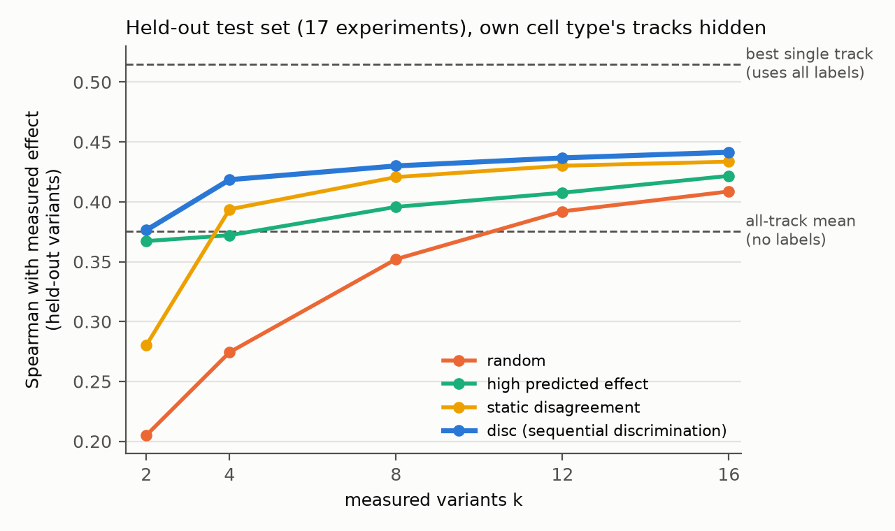

# AuraGenome-V

**Choosing which foundation-model track to trust for a cell type the model does not profile, from a handful of measurements.**

Genomic foundation models such as AlphaGenome predict the effect of any variant on thousands of functional
tracks (cell types × assays). When the cell type of interest is not among them, a researcher has to pick a proxy
track, and that choice can flip conclusions. AuraGenome-V (working name) treats every track as a hypothesis,
chooses the few variants whose measurement best discriminates between the tracks (sequential Bayesian model
discrimination), and returns a posterior-weighted prediction with a stopping rule; a visual-analytics interface
will show how the posterior spreads over track clusters. Validation uses saturation-mutagenesis MPRA
(Kircher et al. 2019) with labels masked.

> **Pre-registered Siraj test (2026-10-29): all four primary hypotheses hold; the safety-net claim is supported.**
> Frozen v2 on 125 new loci of the Siraj 2026 saturation MPRA (K562 and HepG2, pre-registered in commit 239d903):
> - with matched tracks kept, 8 labels are non-inferior to the matched mean (+0.010, one-sided lower bound +0.005;
>   3/125 loci worse by more than 0.05);
> - with own and related cell tracks hidden, 8 labels beat the all-track mean (+0.047, p = 3e-12);
> - with only own cell tracks hidden, 16 labels beat the related-cell mean (+0.040, p = 3e-19).
>
> These numbers use effects relative to the measured reference oligo (2026-10-30, after review;
> docs/internal/siraj_refnorm_zh.md, `results/a1/siraj_ref/`). The original run on the published, element-centred
> skew (`results/a1/siraj_*.tsv`) is kept as historical; every contrast differs by at most 0.002 per locus.
>
> The discrimination panel is essential: a random panel falls below the label-free mean. Results are in
> `results/a1/siraj_*.tsv` and section 8 of docs/internal/preregistration_v2_siraj_zh.md.
>
> **Training-exposure check (C1, docs/internal/c1_robustness_zh.md).** We reran the Kircher test using, for each
> locus, the AlphaGenome checkpoint that held its genomic fold out. The declared reading is "depends on training
> exposure":
> - disc beats random panels even more clearly (+0.093, p = 0.0015);
> - the advantage over the all-track mean weakens (+0.054, p = 0.062, 11 regions);
> - v2 vs the matched mean moves from +0.001 to −0.006, with harmed regions unchanged at 1;
> - absolute accuracy drops by about 0.035 throughout.
>
> The same check on the 125 Siraj loci (thresholds of the Siraj pre-registration, reading rule committed before
> scoring) gives "safety net not dependent on training exposure": all four primary hypotheses still hold and every
> contrast grows (P1 +0.024, lower bound +0.016, 1/125 loci harmed; P3 +0.050; P4 +0.053; reference-relative labels). Absolute accuracy drops by
> 0.04–0.07, most for the matched-track mean (0.474 → 0.402). Results are in `results/a1/siraj_ref/c1/` (historical: `results/a1/c1_siraj/`).
>
> **Acquisition comparators (2026-10-30, post hoc, spec committed before the runs;
> docs/internal/acquisition_comparators_zh.md).** A one-round panel fixed before any measurement is equivalent to
> the sequential one (Siraj: within 0.002–0.005, every 95% interval inside ±0.02), so the panel can be assayed in a
> single round. Direct expected information gain does not improve on the Box–Hill score. A stopping rule based on
> the stability of the averaged prediction stops after 4–8 labels but fails the declared non-inferiority to 16
> labels. Tables in `results/a1/cmp/` and, for reference-relative Siraj labels, `results/a1/siraj_ref/cmp/`.
>
> **Directional accuracy (2026-10-30, post hoc, docs/internal/direction_accuracy_zh.md).** On Siraj the share of
> significant held-out variants with the correct predicted sign agrees with the rank results. On the 11 Kircher
> regions it does not: with matched tracks kept, v2's calibrated prediction calls fewer signs correctly than the
> matched mean (−0.133 at k = 8) because the fitted offsets move its zero point; without the offsets it is level in
> 9/11 regions. Tables in `results/a1/direction/`.
>
> **Active model selection baselines (2026-10-30, post hoc, docs/internal/coda_baseline_zh.md).** Regression
> versions of MODEL SELECTOR and CODA (calibrated likelihood, no metadata, expected-information-gain panel, one
> reported track; CODA's consensus weight fixed on the development set before the test runs). v2 beats the
> CODA-style track by 0.075 on Siraj with matched tracks kept and by 0.029–0.034 without them, and by 0.051–0.082 on
> the Kircher test regions. With the baseline's posterior average instead of one track and no metadata, it is level
> with v2. Tables in `results/a1/coda/`.

> **EIG convergence check (2026-11-01, post hoc, docs/internal/eig_convergence_zh.md).** The information-gain panel
> kept the 100 most probable hypotheses, which without an anchor held as little as 23% of the posterior mass. Keeping
> 99% of the mass at every step with twice the quadrature points changed accuracy by at most 0.001 and stayed level
> with disc. Tables in `results/a1/eigconv/`; supplementary tables S1–S6 are built by `paper/make_supplement.py`.
>
> **Manuscript draft** for *Bioinformatics* is in [paper/](paper/) (`main.tex`, `main.pdf`; plain-Chinese version
> `plain_zh.md`). Red TODOs mark what is missing before submission.

> **Method v2 (2026-10-29, docs/internal/method_v2_zh.md):** the matched-track mean enters as a hypothesis with
> prior mass 0.95 and a positive slope prior (chosen on the development set by a rule declared before the runs, then
> frozen and pushed before the test run). On the Kircher test regions, with matched tracks kept, v2 ties the matched
> mean at k = 8 (+0.001; 1/11 regions harmed vs 7/11 for v1) and is ahead at k = 16 (+0.018, none harmed); rescue is
> slower (LDLR 0.25 → 0.29 at k = 8, 0.41 at k = 16). Its inference ties a metadata-centred ridge on the same panel, so
> the increment comes from the panel choice; 8-label affine recalibration of the matched mean is harmful (sign flips).

> **Status (2026-10-29): pilot passed; method v2 needed.** On the pre-registered held-out test (11 regions, 17 MPRA
> experiments, tracks of the element's own and related cell types hidden), 8 discrimination-chosen measurements beat
> random panels (+0.08 Spearman, Wilcoxon p = 0.003) and the label-free all-track mean (+0.07, 8/11 regions); the
> advantage over picking variants with the largest predicted effect is not significant (+0.03, p = 0.14). With the
> same 8 labels it also beats LASSO over all tracks, the protocol AlphaGenome uses on this benchmark (+0.11 to +0.18
> depending on how degenerate LASSO fits are scored, p = 0.002; added after the pre-registration).
> **Limitation found after the test:** when metadata-matched or related-cell tracks are kept, simply averaging them
> is as good as the method (method − matched mean −0.03, 3/11 regions positive); the method helps where the matched
> proxy is poor (e.g. LDLR 0.24 → 0.51). The next version puts metadata into the prior and will be tested on a
> second dataset. Re-scoring every method and reference on one common evaluation set (variants outside the pool)
> leaves all conclusions unchanged (`results/a1/common_eval_*`). Cross-model novelty check: PROCEED WITH CAUTION
> (7/10); cross-model review: PROCEED WITH CAUTION, readiness 5/10.
> Collaborators: start with **[docs/STATUS_zh.md](docs/STATUS_zh.md)** (project overview, in Chinese) and the
> figures in [results/a1/](results/a1/).



## TrackPilot: the tool

TrackPilot is the method of this repository as a Python package and command-line tool. Give it the predicted effects
of the variants in a region on every track of a foundation model, and the names of your cell type in the track
metadata if the model profiles it. It then

1. **`trackpilot suggest`** picks a pilot panel: the few variants (8 in the paper) whose measurement best tells the
   tracks apart. The whole panel is fixed in one round, so it can be ordered at once.
2. **`trackpilot predict`** takes your measurements of the panel and returns the posterior over tracks, a calibrated
   prediction for every unmeasured variant (the posterior average), the same prediction without the fitted offsets
   (`prediction_no_offset`, for calling effect directions), and an HTML report. An applicability check asks whether
   the measurements follow any track better than shuffled labels do; if not (P > 0.5), no track carries the assay's
   signal and `prediction_checked` falls back to the label-free default (matched-track or all-track mean).

```bash
pip install -e .                       # from a clone; PyPI release planned
cd examples
trackpilot suggest example_predictions.tsv.gz -k 8 -o panel.tsv            # no matched tracks: unprofiled cell type
# ... measure the 8 variants in panel.tsv; here we take them from example_measurements.tsv:
python -c "import pandas as pd; p = pd.read_csv('panel.tsv', sep='\t'); m = pd.read_csv('example_measurements.tsv', sep='\t'); m[m.variant_id.isin(p.variant_id)].to_csv('measured.tsv', sep='\t', index=False)"
trackpilot predict example_predictions.tsv.gz measured.tsv -o predictions.tsv --posterior tracks.tsv --report report.html
```

- **Predictions** (`PREDICTIONS`): a TSV with one row per variant and track and columns `variant_id`, `track_name`,
  `raw_score`, and optionally `output_type`, `track_strand` and `biosample_name`. This is the tidy format of
  AlphaGenome's `tidy_scores`, so any model works once its scores are in this shape (we also used Enformer). A wide
  table (variants × tracks) works too. `trackpilot score-alphagenome --region chr:start-end -o predictions.tsv.gz`
  scores every substitution of a region with AlphaGenome (needs `pip install -e ".[alphagenome]"` and your own key in
  `ALPHAGENOME_API_KEY`).
- **`--anchor`**: keywords naming your cell type in the track metadata (e.g. `K562`, or `liver;hepatocyte`). The mean
  of the matching tracks becomes the anchor hypothesis with prior 0.95; measurements can overrule it. Without a
  match, TrackPilot starts from equal weight on each family of near-identical tracks.
- **Labels** (`predict`): a TSV/CSV with `variant_id` and `effect` (e.g. log2 fold change, alt vs ref).
- **Python**: `TrackPilot(X, anchor_mask).suggest(8)`, `.fit(labels).predict()`; see `src/trackpilot/core.py`.

**How many variants to measure (`-k`).** The panel size is yours to set; 8 is the default and the size the paper's
pre-registered tests used. TrackPilot still weighs every track: `k` is the number of measured variants, not of tracks.
- Each track hypothesis spends two degrees of freedom on its calibration (slope and offset), so 2–4 labels mostly fix
  the calibration. On Siraj, 2 measurements were below the label-free default in every scenario; 4 beat it only when
  matched tracks were hidden; 8 beat it in every scenario.
- The applicability check permutes the `k` labels, which have only `k!` orderings (24 for `k = 4`), so it needs about
  8 labels to reach small P values.
- Accuracy kept rising up to 16 labels, most in cell types far from every profiled one (Kircher mouse-cell regions:
  0.243 at `k = 8`, 0.265 at `k = 16`, all-track mean 0.246).
- Measure in rounds: `trackpilot suggest PREDICTIONS -k 8 --measured first_round.tsv -o next.tsv` proposes 8 more
  variants given the labels you already have, and `trackpilot predict` accepts any number of labels.

The method's parameters are those frozen before the paper's tests (α = 0.1, β = 0.5, anchor prior 0.95, track
families at correlation 0.9). On a laptop (Apple M2 Pro), a region of 1,353 variants × 1,018 tracks takes about 1 s
to set up, 0.1 s per panel and 0.01 s per prediction.

**Tests.** `pytest` runs unit tests on the synthetic example. With the paper's local data present it also checks that
the package reproduces the frozen runs: `pilot/scripts/trackpilot_reproduce.py kircher|siraj` recomputes the pilot
panel and held-out accuracy for every element and scenario and compares them with the pre-registered runs (maximum
difference 0 on all 22 Kircher experiments and 125 Siraj loci).

## Repository layout

```
src/trackpilot/             the TrackPilot package (core.py method, io.py input, cli.py commands, report.py)
tests/                      unit tests; test_reproduce.py checks the package against the paper's frozen runs
examples/                   synthetic example (make_example.py regenerates it)
pilot/
  scripts/
    download_data.py        ground truth: Kircher et al. 2019 saturation-mutagenesis MPRA (pinned, checksummed)
    build_variant_table.py  SNV table (GRCh38) with measured effects and ground-truth classes
    alphagenome_score.py    AlphaGenome in-silico mutagenesis per element (--all-biosamples keeps every track)
    proxy_select.py         A1 method (frozen) and baselines: panel strategies x budgets x repeats
    prereg_test.py          pre-registered held-out test and decision rule
    a1_report.py            collects tracked tables and figures into results/a1/
    compute_signals.py      superseded "reliability profile" pilot (kept for reference)
    borzoi_score.py         Borzoi replicate scores (GPU; planned robustness analysis)
  data/, predictions/, results/   downloaded and derived data (not tracked)
results/a1/                 tracked summary tables and figures (c1/c1_siraj: held-out-fold checkpoint reruns)
paper/                      Bioinformatics manuscript draft (OUP template; build: cd paper && tectonic main.tex)
docs/STATUS_zh.md           project overview for collaborators (Chinese)
docs/internal/              pre-registration, pilot notes, idea-selection report; older plans marked superseded
```

## Reproduce

Requires Python ≥ 3.10 and an AlphaGenome API key (non-commercial terms; each person uses their own key,
exported in the shell, never committed).

```bash
python -m venv .venv && source .venv/bin/activate
pip install -r requirements.txt
python pilot/scripts/download_data.py pilot
python pilot/scripts/build_variant_table.py pilot
export ALPHAGENOME_API_KEY=...
# development set (5 elements, ~25 min of API time)
python pilot/scripts/alphagenome_score.py pilot --all-biosamples --outputs CAGE,DNASE,ATAC --versions ALL_FOLDS --elements PKLR-48h,F9,HNF4A,IRF6,BCL11A
python pilot/scripts/proxy_select.py pilot
# ablations
python pilot/scripts/proxy_select.py pilot --noise --tag noise
python pilot/scripts/proxy_select.py pilot --ensemble --tag ensemble
python pilot/scripts/proxy_select.py pilot --ensemble --noise --tag full
# held-out test set (pre-registered: docs/internal/preregistration_A1_zh.md)
TEST=FOXE1,GP1BA,HBB,HBG1,IRF4,LDLR,LDLR.2,MSMB,MYCrs11986220,MYCrs6983267,SORT1,SORT1-flip,SORT1.2,TERT-GAa,TERT-GBM,TERT-GSc,TERT-HEK
python pilot/scripts/alphagenome_score.py pilot --all-biosamples --outputs CAGE,DNASE,ATAC --versions ALL_FOLDS --elements $TEST
python pilot/scripts/proxy_select.py pilot --elements $TEST --tag test
python pilot/scripts/prereg_test.py pilot
python pilot/scripts/a1_report.py pilot results/a1
```

## Data and model terms

- **Ground truth:** Kircher M, *et al.* (2019) *Nat Commun* 10:3583, doi:10.1038/s41467-019-11526-w. The data are
  downloaded from the authors' portal repository and are not redistributed here; cite the publication for any use.
- **Second dataset:** Siraj L, *et al.* (2026) *Nature*, doi:10.1038/s41586-026-10121-6; saturation mutagenesis data
  on Zenodo, doi:10.5281/zenodo.15297965, CC-BY-NC-4.0. The data are not redistributed here.
- **AlphaGenome:** API and weights are available for non-commercial use under Google DeepMind's terms of use.
  Predictions are not redistributed here; the scoring scripts regenerate them.
- **Borzoi:** Linder J, *et al.* (2025) *Nat Genet*; PyTorch weights via `borzoi-pytorch` (check the licence of
  the port you use).

## Licence

- **Code** (`src/trackpilot/`, `tests/`, `examples/`, `pilot/scripts/`, `paper/make_figures.py` and other scripts): MIT, see [LICENSE](LICENSE).
- **Tables derived from the Siraj et al. data** (`results/a1/siraj_*`, `results/a1/c1_siraj/`, `results/a1/cmp/cmp_siraj_*`, `results/a1/siraj_ref/`, `results/a1/direction/`, `results/a1/coda/coda_siraj_*`, `results/a1/eigconv/eigconv_siraj_*`, `paper/supplement.pdf`): CC-BY-NC-4.0, the
  licence of the source data. Cite Siraj et al. (2026) and the Zenodo record when using them.
- **Manuscript draft** (`paper/` text and figures): not licensed for reuse. The MIT licence does not apply to it.
