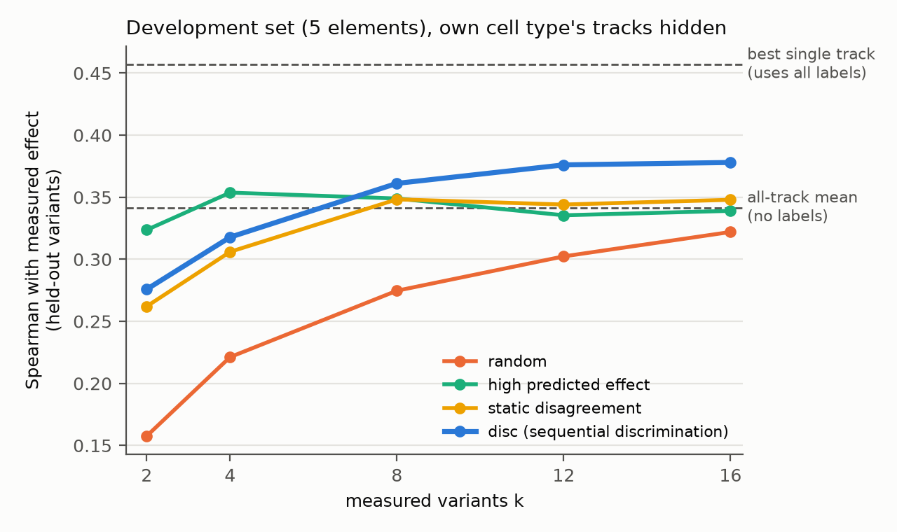
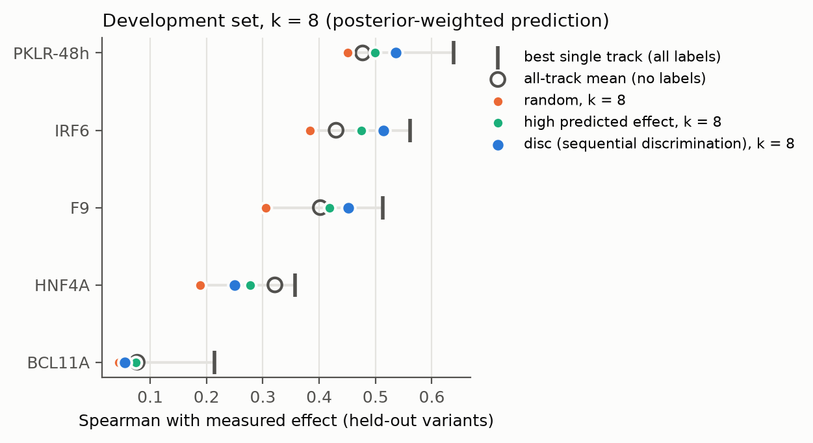
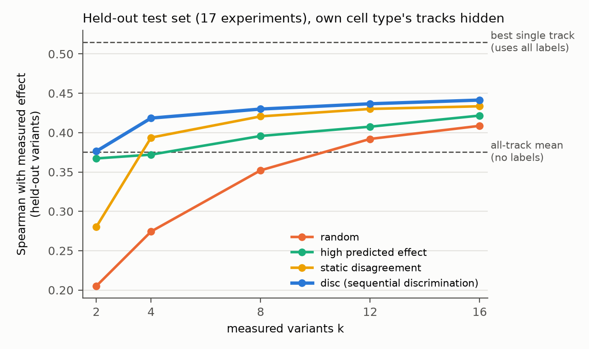
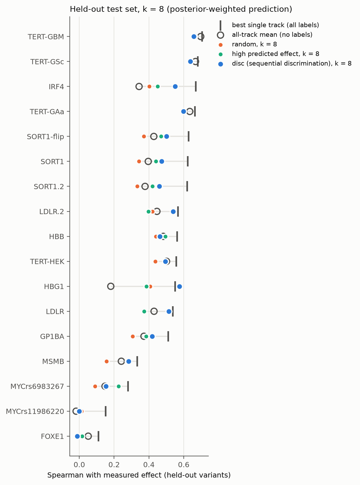

# AuraGenome-V 项目进展总览（给合作作者）

> 最后更新：2026-10-29。目标期刊：*Bioinformatics*，Original Paper。
> **当前状态**：
> - 方向已选定为 A1。开发集试点已完成，方法和检验方案已经预注册。
> - **预注册的检验集判定为 GO**（H1、H2 成立，H3 不成立），见第 5 节。
> - 在 8 个标签下，我们的方法明显优于 AlphaGenome 论文的 LASSO 做法：+0.11 到 +0.18，p = 0.002。这是预注册之后补充的基线。
> - **Codex 查新（10/29）：PROCEED WITH CAUTION，7/10。** 没有找到已发表的相同工作。
> - **新发现（10/29，重要）**：如果模型里有元数据匹配或相近细胞的轨道，直接用这些轨道的平均就不比我们的方法差。8 个标签时，我们的方法平均低 0.032，11 个区域中只有 3 个更好。我们的方法只在匹配轨道不准的地方明显更好，见第 5 节的"部署场景对比"。
>
> - **方法 v2（10/29）**：加入元数据锚点先验后，部署场景的损害从 7/11 个区域降到 1/11（8 个标签）和 0/11（16 个标签）。但 v2 的推断没有超过以元数据为中心的简单岭回归，增量主要来自选点。
> - **Siraj 预注册检验（10/29 15:30）：P1–P4 全部成立，"安全网"主张成立。** 10/30 按第二轮评审把标签改为"突变体 − 实测参照 oligo"后重跑，结论不变，下面是新标签下的数字（见 [siraj_refnorm_zh.md](internal/siraj_refnorm_zh.md)）。125 个新位点上：
>   - 保留匹配轨道时，v2 不比匹配平均差（+0.010，下界 +0.005），只有 3/125 个位点明显变差；
>   - 藏起本细胞和相关细胞时，8 个标签比全轨道平均高 +0.047；
>   - 只藏起本细胞时，16 个标签比相关细胞平均高 +0.040。
>   - 两种标签之间，四个对比逐位点平均最多相差 0.002。
>   - 见第 5 节"Siraj 预注册检验"。
> - **Codex 研究评审（10/29）：PROCEED WITH CAUTION，不建议放弃。** 论文成熟度现在 5/10，下面的计划成功后预期 7/10。详见第 6 节第 6 条。
>
> **接下来按这个顺序做**（评审建议的顺序）：
> 1. ~~修正评估：所有方法都在同一组池外变异上打分~~。**已完成（10/29 07:20），结论不变**，见第 5 节"统一评估集复核"；
> 2. ~~方法 v2：最小的"元数据先验"版本，加上几个简单对照~~。**已完成（10/29）**，见第 5 节"方法 v2"和 [method_v2_zh.md](internal/method_v2_zh.md)。保住做到了（检验集 8 个标签时与匹配平均持平，16 个标签时没有区域受损）；救回需要约 16 个标签。在同一组选点上，v2 与以元数据为中心的岭回归打平；
> 3. ~~冻结 v2，在 Siraj SatMut 上预注册检验~~。**已完成（10/29 15:30）：P1–P4 全部成立，判定为"安全网"主张成立**，见 [preregistration_v2_siraj_zh.md](internal/preregistration_v2_siraj_zh.md) 第 8 节。**C1 稳健性分析也已完成（10/29 16:21）**，按事先规则判定为"结论依赖训练暴露"：
>    - 用留出该位点所在折的检查点后，H1（disc 优于随机）更强，p = 0.0015；
>    - H2（disc 优于全轨道平均）减弱为 +0.054，p = 0.062；
>    - v2 相对匹配平均从 +0.001 变为 −0.006，变差区域仍是 1 个；
>    - 绝对精度普遍下降约 0.035。
>    - **扩展到 Siraj 的 125 个位点（10/29 19:40）：判定为"安全网主张不依赖训练暴露"。** 留出折下 P1–P4 全部成立，而且优势变大：P1 +0.024（下界 +0.016，受损 1/125），P3 +0.050，P4 +0.053（新标签；原标签下 +0.024、+0.052、+0.054）。绝对精度下降 0.04–0.07，其中匹配平均掉得最多（0.474 → 0.402）。Kircher 上 H2 的减弱在大样本上没有重现；
>    - 见 [c1_robustness_zh.md](internal/c1_robustness_zh.md)；
> 4. 根据 Siraj 结果确定论文主张，写 *Bioinformatics* 论文。**论文初稿已完成（10/29），在 [`paper/`](../paper/)**：`main.tex`（OUP 模板）、`main.pdf`、大白话中文版 `plain_zh.md`、规划 `PAPER_PLAN.md`。投稿前作者必须亲自重写正文（期刊禁止用 LLM 起草论文），并补 Zenodo 存档、作者信息等红色 TODO。方法上再补一个算法改进：批量选点或停止规则重设计，评审也要求批量选点作为基线；
> 4b. **选点方法补充对照（10/30，事后分析，规格先提交）**：见 [acquisition_comparators_zh.md](internal/acquisition_comparators_zh.md)。
>    - 一轮批量选点（batch_kb）与顺序选点等价（Siraj 上差 0.002–0.005，区间都在 ±0.02 内）：实验可以一轮做完；
>    - 直接算期望信息增益（EIG）没有改进（差 ≤ 0.003）；
>    - 新停止规则（后验平均预测稳定即停，阈值在开发集上冻结为 0.99）约 4–8 个标签就停，相对测满 16 个损失 0.014–0.027，按事先规则判为失败；
>    - 附带：Siraj 上没有锚点时，disc 比"挑预测效应最大的"高 0.028（97/125，新标签）。
>    - 新标签下重跑，以上结论全部不变（`results/a1/siraj_ref/cmp/`）。
> 4c. **第二轮评审（10/30，GPT，5/10，MAJOR REVISION）的阻断项已解决**：Siraj 标签改为相对实测参照 oligo，规格先提交（[siraj_refnorm_zh.md](internal/siraj_refnorm_zh.md)），主检验、留出折和选点对照全部重跑，判定不变。论文已换成新数字，并按评审收窄了"安全/不损害"的说法、补了同条件对照 S3b（在我们的选点上重新拟合只差 −0.010）。剩余评审项：MODEL SELECTOR/CODA 回归版基线或改定位为"经过验证的适配流程"、EIG 收敛检查、投稿材料。
> 4d. **方向准确率补充（10/30，事后、描述性，规格先提交）**：见 [direction_accuracy_zh.md](internal/direction_accuracy_zh.md)。Siraj 上与 Spearman 结论一致；**Kircher 上相反**：有匹配轨道时 v2 判断方向比匹配轨道差 0.133（k=8），原因是校准截距移动了零点。去掉截距后 9/11 个区域持平，只有显著变异极少的 FOXE1、MYCrs11986220 仍差。论文 §3.3 末段和局限已如实写出，建议判断方向用去掉截距的加权预测。
> 5. **论文拆分（10/29 作者决定）**：先投 *Bioinformatics*，以方法为主，配结果图和软件包。可视分析的研究问题另写一篇投可视化领域，问题清单见 [vis_paper_questions_zh.md](internal/vis_paper_questions_zh.md)。
> 建议的阅读顺序：本文 → [`results/a1/`](../results/a1/) 中的图表 → [预注册](internal/preregistration_A1_zh.md)。

## 1. 一句话问题

基因组基础模型（如 AlphaGenome）对任意变异都能输出约 6,000 条功能轨道的预测，覆盖各种细胞类型、各种实验类型。如果研究者关心的细胞类型**不在模型的覆盖范围内**，他该参考哪一条轨道？另外，**最少需要实测几个变异**，才能把这条轨道选对？

我们的方法是：先挑出候选轨道之间分歧最大的少量变异去实测，用实测结果在上千条轨道中做贝叶斯判别，然后给出加权预测、一个停止规则和一个可视分析界面。

- **CS 贡献**：在上千个高度相关的候选模型之间，用尽量少的标签做判别。这是"面向模型判别的主动实验设计"在大规模候选集上的应用。
- **生信贡献**：让实验室用少量 MPRA 测量，就能把基础模型用到模型没覆盖的细胞类型上。

## 2. 选题经过

为什么是这个方向：

1. **最初设想："分层比较环"**（AuraGenome 2.0）。查新后发现与 GenomeSpy 等已有工作重叠较多，放弃。
2. **第二版："基因组 AI 预测的可靠性画像"**。问题有两个：表述太虚；更关键的是，我们计划用作金标准的 Kircher 2019 MPRA（即 CAGI5）**已经是 AlphaGenome 论文里的基准**。我们自己在 PKLR 上的试点也显示模型方向准确率达 96%。因此"模型经常出错"不能作为论文前提。
3. **用 ARIS 做系统选题**：两个 GPT 模型共生成 15 个候选想法，再由交叉模型评审排序，前三名是 A1、C1、E1。
   - 详见 [idea_discovery_report.md](internal/idea_discovery_report.md)。
   - Codex 的正式查新结论还没拿到（额度限制）。
4. **选定 A1**。C1（训练暴露对单个位点的影响）降为 A1 论文中的稳健性分析；E1（可证伪的 LLM 解释）留作后续论文。

**动机证据**（PKLR，K562 细胞）：把匹配的 K562 轨道换成 HepG2 轨道后，

- 显著变异上的方向准确率从 0.96 降到 0.69–0.85；
- 与实测效应的 Spearman 从约 0.90 降到 0.30–0.70；
- 两组轨道在 13–32% 的显著变异上方向相反。

也就是说，**选错轨道，结论就会变**。

## 3. 方法（A1，已冻结）

代码：[`pilot/scripts/proxy_select.py`](../pilot/scripts/proxy_select.py)。

- **候选假设**：AlphaGenome 对所有生物样本给出的 CAGE、DNase、ATAC 轨道，共 1,018 条。每条轨道 t 是一个假设："实测效应 y = a + b·z_t + 噪声"，其中 z_t 是该轨道的预测。
- **轨道打分**：对 a、b 设高斯先验，算出每条轨道在已测变异上的边际似然，从而得到所有轨道的后验分布。
- **选点策略**（`disc`）：每一步挑这样一个变异——各轨道按后验加权后，对它的预测分歧最大（Box–Hill 型模型判别设计）。
- **输出**：主输出是后验加权的预测。同时报告最大后验的那条轨道。
- **停止规则**：推荐的代理轨道连续两步不再变化时停止。
- **对照**：
  - 其他选点策略：随机选；挑预测效应最大的（常用做法）；静态分歧（不随后验更新）。
  - 不用标签的参照：全轨道平均；按名称匹配的轨道；最佳单轨道（用到全部标签，作为上限）。
- **评估方式**：从 MPRA 数据中藏起标签再还原。可测变异池占 50%，重复 200 次，在留出变异上算 Spearman。
- **主场景**：把元件本身细胞类型的轨道藏起来，模拟"模型没覆盖的细胞类型"。

## 4. 当前结果：开发集，5 个元件





测 8 个变异，后验加权预测，留出变异上的 Spearman：

| 元件 | disc | 随机 | 高预测效应 | 全轨道平均（无标签） | 最佳单轨道（上限） |
|---|---|---|---|---|---|
| PKLR-48h | **0.54** | 0.45 | 0.50 | 0.48 | 0.64 |
| IRF6 | **0.51** | 0.38 | 0.47 | 0.43 | 0.56 |
| F9 | **0.45** | 0.31 | 0.42 | 0.40 | 0.51 |
| HNF4A | 0.25 | 0.19 | 0.28 | **0.32** | 0.36 |
| BCL11A | 0.05 | 0.04 | 0.07 | **0.08** | 0.21 |
| 平均 | **0.36** | 0.27 | 0.35 | 0.34 | 0.46 |

结论分三类。

**站得住的：**
- **选哪些变异去测，影响很大。** disc 在 5 个元件上都优于随机选点，平均高 0.09。
- **按名称匹配细胞类型并不可靠。** 在 1,018 条轨道中，按名称匹配到的轨道排名分别是：PKLR 第 1、BCL11A 第 5、HNF4A 第 10、F9 第 26、IRF6 第 27。例如 F9（HepG2）表现最好的是 HeLa-S3 和 K562 的 CAGE 轨道；IRF6（HaCaT）表现最好的是几株上皮细胞系。

**站不住的（目前）：**
- **相对"不用标签、直接平均全部轨道"，提升很小。** k=8 时只高 0.02，5 个元件中只有 3 个为正。
- **disc 相对"挑预测效应最大的"优势也很小**，只高 0.01，不显著。
- **原因**：表现差的两个元件，要么显著变异极少（BCL11A 的 1,799 个变异中只有 36 个显著），要么可提升空间很小（HNF4A 的上限只比全轨道平均高 0.04）。

**消融实验**（[`results/a1/dev_ablation.tsv`](../results/a1/dev_ablation.tsv)）：
- 加入每个变异的 MPRA 测量误差：几乎没有影响。
- 加入"集成假设"（全轨道平均、名称匹配平均）：提升了小样本时单轨道选择的下限，但压低了上限，后验加权预测不变。
- 因此冻结最简单的版本。

## 5. 预注册与检验集（进行中）

[预注册文件](internal/preregistration_A1_zh.md) 与冻结代码在同一个 commit 中提交，写于检验数据生成之前。

- **检验集**：其余 17 个人类细胞实验，分布在 11 个基因组区域。分析单位是区域。
- **H1**：disc 优于随机选点（Wilcoxon 检验，p < 0.05）。
- **H2**：disc 比全轨道平均平均高至少 0.03，且至少 7/11 个区域为正。
- **H3**（次要）：disc 优于"高预测效应"选点。
- **判定规则**：
  - H1 和 H2 都成立：GO。
  - 只有 H1 成立：论文需要重新定位。
  - H1 不成立：放弃 A1 的核心主张。
- **开发集上的判定**：REFRAME（只有 H1 成立）。脚本 [`prereg_test.py`](../pilot/scripts/prereg_test.py) 已经写好，检验数据一到就自动出结论。

### 检验集结果（2026-10-28 18:20，方法和参数未作任何改动）





预注册检验（11 个区域，k=8，后验加权预测；完整输出见 [`results/a1/test_decision.txt`](../results/a1/test_decision.txt)）：

| 假设 | 结果 | 是否成立 |
|---|---|---|
| H1 disc > 随机 | 平均高 0.081，11 个区域中 9 个更好，Wilcoxon p = 0.003 | ✅ |
| H2 disc − 全轨道平均 | 平均高 0.070，11 个区域中 8 个为正 | ✅ |
| H3 disc > 高预测效应 | 平均高 0.034，p = 0.14 | ❌ |
| **判定** | **GO** | |

逐区域结果（k=8，后验加权预测；同一区域的多个实验已取平均）：

| 区域（实验） | disc | 随机 | 高预测效应 | 全轨道平均 | 最佳单轨道 | 显著变异数 |
|---|---|---|---|---|---|---|
| HBG1 | **0.58** | 0.41 | 0.39 | 0.18 | 0.55 | 168 |
| IRF4（SK-MEL-28，模型未覆盖） | **0.55** | 0.40 | 0.45 | 0.34 | 0.67 | 643 |
| LDLR（×2） | **0.53** | 0.40 | 0.38 | 0.44 | 0.55 | 293–379 |
| SORT1（×3） | **0.48** | 0.35 | 0.44 | 0.40 | 0.62 | 637–754 |
| GP1BA | **0.42** | 0.31 | 0.39 | 0.37 | 0.51 | 178 |
| MSMB | **0.28** | 0.16 | 0.28 | 0.24 | 0.33 | 252 |
| HBB | 0.46 | 0.44 | **0.50** | 0.48 | 0.56 | 82 |
| TERT（×4，含 3 个胶质瘤细胞系） | 0.60 | 0.58 | 0.60 | **0.63** | 0.65 | 117–278 |
| MYCrs6983267 | 0.15 | 0.09 | **0.23** | 0.15 | 0.28 | 76 |
| MYCrs11986220 | 0.00 | 0.01 | 0.00 | −0.02 | 0.15 | 11 |
| FOXE1 | −0.01 | 0.01 | 0.02 | **0.05** | 0.11 | 5 |

如何解读：

- **提升集中在有信号、也有提升空间的元件上。** 在 HBG1、IRF4、LDLR、SORT1 上，8 个实测值把结果从全轨道平均明显推向上限。HBG1 的后验加权预测甚至超过了最佳单轨道。
  - 用中位数衡量，disc 收回了"全轨道平均到上限"这段差距的约 1/3。
  - 其中 IRF4 的细胞系 SK-MEL-28 是模型没有覆盖的细胞类型，正是论文的目标场景。
- **没有提升的情况可以解释。**
  - 显著变异极少时没有提升：FOXE1 只有 5 个，MYCrs11986220 只有 11 个，8 个标签基本都是噪声。
  - 全轨道平均已经接近上限时没有提升：TERT 的平均 0.63，上限 0.65。
  - 这两类情况下 disc 与平均持平或略低，最多低 0.06（FOXE1）。
- **事后稳健性检查（不属于预注册）：**
  - 去掉提升最大的区域 HBG1 后，平均差仍有 +0.038，10 个区域中 7 个为正，依然满足 H2。
  - 去掉 IRF4 后，平均差为 +0.056，同样满足。
  - 区域间差值的中位数是 +0.041。
- **开发集与检验集结论不同。** 开发集只有 5 个元件，其中两个信号很弱或几乎没有提升空间（BCL11A、HNF4A），所以 H2 在开发集上不成立。检验集更大，判定以预注册的检验集为准。两组结果都会如实报告。
- **停止规则**：平均在 7–11 个标签时停止，效果与固定 k=8 相当。

### 补充基线：AlphaGenome 论文的做法（预注册之后补充，属于事后分析）

AlphaGenome 论文在 CAGI5（即 Kircher 数据）上的做法，是用全部标签对所有轨道做 LASSO 回归。审稿人一定会问：如果只给 8 个标签，这种做法表现如何？所以补了两个回归基线：LASSO 和 ridge，都对全部 1,018 条轨道回归，惩罚强度用留一法选取。

- 每个基线都分别用随机选的变异和 disc 选的变异来训练。
- 只跑了前 50 次重复。
- 方法本身没有改动，原有结果逐行复现、完全一致。
- 结果见 [`results/a1/regression_baselines_k8.tsv`](../results/a1/regression_baselines_k8.tsv)。

检验集，k=8，区域层面：

| 对比 | 平均差 | 为正的区域 | Wilcoxon p（单侧） |
|---|---|---|---|
| 我们的方法 vs 随机选点 + LASSO（≈ AlphaGenome 论文做法，只给 8 个标签） | **+0.117** | 9/11 | 0.002 |
| 我们的方法 vs 随机选点 + ridge | +0.111 | 8/11 | 0.007 |
| 我们的方法 vs disc 选点 + LASSO（选点相同，只换预测器） | +0.035 | 8/11 | 0.012 |
| 我们的方法 vs disc 选点 + ridge | +0.024 | 8/11 | 0.042 |

开发集上同样四项对比，5 个元件全部为正。

**关于 LASSO 的缺失值（10/29 补充）。** LASSO 有时会把所有系数压成 0，这时预测是常数，Spearman 没有定义。检验集 k = 8 时，随机选点 + LASSO 有 26% 的重复属于这种情况，disc 选点 + LASSO 有 10%。上表的做法是直接丢掉这些重复。现在换成另外两种规则重算：

| 规则 | vs 随机 + LASSO | vs disc + LASSO |
|---|---|---|
| 无定义记为 0 | +0.178 | +0.048 |
| 退回到全轨道平均 | +0.107 | +0.034 |
| 丢掉（上表） | +0.117 | +0.035 |

三种规则下 p 值都分别是 0.002 和 0.012，结论不变。

### 部署场景对比：保留匹配轨道（10/29，事后分析，重要）

Codex 评审指出，主分析的 `hide_matched` 场景不只藏起了本细胞类型的轨道，还藏起了相近细胞的代理轨道。例如：HEL 对应 K562，胶质瘤对应 SK-N-SH 和星形胶质细胞，SK-MEL-28 对应黑色素细胞。所以主分析是一个压力测试。

真实使用时，研究者手里有这些代理轨道。所以我们又做了一组对比：保留全部轨道，以"元数据匹配轨道的平均"（不用标签）作为参照。结果见 [`results/a1/deployment_vs_matched.tsv`](../results/a1/deployment_vs_matched.tsv)。

检验集，区域层面：

| 对比 | k = 8 平均差 | 为正的区域 | k = 16 平均差 |
|---|---|---|---|
| 我们的方法（加权预测）− 匹配轨道平均 | −0.032 | 3/11 | −0.020 |
| 我们的方法（MAP 轨道）− 匹配轨道平均 | −0.077 | 1/11 | −0.054 |
| 随机选点 − 匹配轨道平均 | −0.115 | 1/11 | −0.056 |

我们的方法比匹配轨道好的，都是匹配轨道本身不准的元件：
- LDLR：匹配轨道是 HepG2，0.24，我们的方法 0.51；
- MSMB：0.17 对 0.28；
- HBG1：0.52 对 0.59。

匹配轨道已经很准的元件上，我们的方法反而更差：
- SORT1：0.65 对 0.48；
- HBB：0.65 对 0.47；
- IRF4：0.65 对 0.58。

开发集上的情况相同：平均低 0.048，5 个元件中只有 1 个更好。消融实验里加入"匹配轨道平均"作为假设、给它先验权重后，差距从 −0.048 缩小到 −0.027。

**结论**：当前的方法 v1 有一个明显缺陷：它不知道哪些轨道在元数据上与目标细胞相近，所以把好的先验知识浪费掉了。下一步方法 v2 要把元数据写进先验，让匹配轨道先占较大的权重，只有实测结果和它们矛盾时才转向其他轨道。

### 统一评估集复核（10/29，评审要求的修正）

评审指出了原来评估方式的一个问题：
- 各选点策略都在"自己没选中的变异"上打分；
- 不用标签的参照（全轨道平均、匹配轨道平均、最佳单条轨道）则在全部变异上打分。

这样一来，不同方法比较的不是同一组变异。现在 `proxy_select.py` 加了 `--common-eval` 选项：每次重复中，所有方法和参照都只在这次的"可测池"以外的变异上打分。
- 方法和参数都没有改；
- 不加这个选项时，输出和原来逐行一致，已核对；
- 22 个元件全部重跑，200 次重复。

| 检验集，k = 8，区域层面 | 原评估 | 统一评估集 |
|---|---|---|
| H1：disc − 随机 | +0.081，9/11，p = 0.0034 | +0.084，9/11，p = 0.0024 |
| H2：disc − 全轨道平均 | +0.070，8/11 | +0.074，8/11 |
| H3：disc − 预测效应最大 | +0.034，p = 0.14 | +0.031，p = 0.18 |
| 判定 | GO | GO |
| 部署场景：disc − 匹配轨道平均 | −0.032，3/11 | −0.029，3/11 |

开发集的均值也几乎不变：disc 从 0.361 变为 0.363，随机选点仍是 0.275。所以原来的评估方式没有影响结论。

文件：
- [`results/a1/common_eval_*`](../results/a1/)
- [`fig5_test_learning_curve_common_eval.png`](../results/a1/fig5_test_learning_curve_common_eval.png)

预注册的原始结果照原样保留。

回归基线在统一评估集上的重跑已完成（10/29 11:00），结论不变。检验集 k = 8，11 个区域：

| disc 减去 | 原评估 | 统一评估集 | 为正 | 单侧 p |
|---|---|---|---|---|
| random + LASSO | +0.107 到 +0.178 | +0.110 到 +0.182 | 9 到 10/11 | ≤ 0.0024 |
| random + 岭回归 | +0.111 | +0.116 | 8/11 | 0.0068 |
| disc + LASSO | +0.034 到 +0.048 | +0.034 到 +0.048 | 8/11 | ≤ 0.016 |
| disc + 岭回归 | +0.024 | +0.023 | 8/11 | 0.042 |

LASSO 的范围对应三种处理全零系数的规则。详见 `results/a1/common_eval_regression_baselines_k8.tsv`。

v2 的参数只能在 Kircher 开发集上调。调完冻结，再在 Siraj SatMut 上做一次新的预注册检验。Kircher 检验集的现有结果照原样报告，不重新解释。

这组对比说明了两件事：

1. 标签很少时，"对所有轨道做回归"这一标准做法明显不如我们的方法。
2. 可以把方法拆成两部分看。以 LASSO 为例：
   - 换成 disc 选点：+0.08，即从 0.25 到 0.33。
   - 再把回归换成贝叶斯轨道后验：+0.035。

   也就是说，**选点和预测器各自都有贡献**，方法的价值不只在选点规则上。这也部分回应了 H3 不成立的问题。

### 方法 v2：元数据锚点先验（10/29，回应评审）

设计规格先写好再运行，参数只在开发集上选，选定后冻结、推送，然后才运行检验集。详见 [method_v2_zh.md](internal/method_v2_zh.md)。

- **改动**：
  - 把匹配轨道平均作为一个假设，先验质量 π，斜率先验以正值为中心；
  - 轨道先验按预测相关聚类平分（复制轨道不改变结果）；
  - 新增两个同预算对照：用 8 个标签对匹配平均做仿射校正（`matched_cal`），以及以匹配平均为中心的岭回归（`meta_ridge`）。
- **选参**：开发集上按事先声明的规则选中 π = 0.95；留一元件分析中，5 次有 4 次仍选 0.95。

| 检验集，11 个区域 | k = 8：方法 − 匹配平均 | 受损区域（< −0.05） | k = 16：方法 − 匹配平均 | 受损区域 |
|---|---|---|---|---|
| v1 | −0.029 | 7 | −0.014 | 4 |
| v2（冻结） | +0.001 | 1 | +0.018 | 0 |
| 同一组选点 + meta_ridge | +0.002 | — | +0.018 | — |

- **救回较慢**：LDLR 在 8 个标签时 0.25 → 0.29（v1 为 0.53），16 个标签时到 0.41。
- **用 8 个标签对匹配平均做仿射校正有害**：斜率会被翻转，LDLR 降到 0.14。
- **评审停止条件的结论**：v2 的贝叶斯推断没有超过以元数据为中心的简单岭回归；两者都因 disc 选点高约 0.03。"安全网"主张要看 Siraj 上能否在受控损害下救回。另外，停止规则在 v2 下会因先验惯性在 3 个标签就停下，需要重设计。

### Siraj 预注册检验（10/29 15:30，冻结的 v2，运行一次）

数据为 Siraj 2026 饱和突变 MPRA，125 个新位点，每个位点在 K562 和 HepG2 中都有实测；分析单位是位点。预注册于 commit 239d903，结果原文和次要结果见 [preregistration_v2_siraj_zh.md](internal/preregistration_v2_siraj_zh.md) 第 8 节。

| 假设 | 条件，k | 平均差 | 判定 |
|---|---|---|---|
| P1 非劣效 | C1 保留匹配轨道，k = 8：v2 − 匹配平均 | +0.010，单侧 95% 下界 +0.005（界值 −0.02） | 成立 |
| P2 损害受控 | 同上，变差 > 0.05 的位点 | 3/125，上界 0.061（界值 0.15） | 成立 |
| P3 救回，无锚点 | C3 藏起本细胞和相关细胞，k = 8：v2 − 全轨道平均 | +0.048，p = 8e−13 | 成立 |
| P4 救回，相近代理 | C2 只藏起本细胞，k = 16：v2 − 相关细胞平均 | +0.041，p = 1e−19 | 成立 |

**判定：安全网主张成立。** k = 16 时 P1、P2 也成立（+0.020，1/125 个位点变差）。

- **选点是必要的**：C3 中 disc 选点比随机选点高 0.093（122/125）；随机选点时 v2 反而不如全轨道平均（0.346 对 0.391）。
- **v2 略优于 meta_ridge**：+0.008，97/125，与开发集上打平不同，效应很小。
- **少标签仿射校正有害**：matched_cal 比匹配平均低 0.079，125 个位点全部变差。
- **家族先验没有增益**：−0.002，p = 0.11。
- **C1 的增益只能算"不损害"**：+0.010 很小，K562 上的区间跨过 0。
- **局限**：K562 和 HepG2 在模型训练数据里，"未覆盖的细胞"只能靠藏起轨道来近似。

## 6. 风险与待讨论的问题

1. **H3 不成立：disc 相对"挑预测效应最大的变异"优势不显著。** 检验集上平均高 0.034（p = 0.14），在 k = 2–8 时差距较明显（见学习曲线）。论文的主张应该放在"约 8 个实测值即可明显超过不用标签的做法"上，"disc 优于所有简单选点规则"只能作为次要结论。可以考虑的补充：
   - 报告不同 k 下的结果；
   - 增加更多检验元件（例如其他饱和突变 MPRA 数据集）。
2. **方法的新颖性边界（重要）。** 目前找到的最接近的 CS 工作是 **MODEL SELECTOR**（Okanovic、Kirsch、Krause 等，arXiv 2410.13609，AISTATS 2025）。它挑选少量样本去标注，从 1,500 多个预训练分类器里找出最好的一个，可以节省最多 94% 的标注。
   - 思路与我们相近，但有四点不同：
     - 它处理分类问题，我们处理回归问题；而且每条轨道与实测值之间的尺度和偏移是未知的，需要积分掉；
     - 我们输出后验加权预测，而不只是选出一个模型；
     - 候选是同一个基因组模型的上千个高度相关的输出头；
     - 应用场景是模型没覆盖的细胞类型，并且有预注册的检验。
   - 其他相关工作：Model Picker（2021）、CAMS（NeurIPS 2024）、Box & Hill (1967) 的模型判别实验设计。
   - **论文必须引用 MODEL SELECTOR。最好把它改造成回归版本，作为一个基线进行比较。**
   - **Codex 查新结论（10/29）：PROCEED WITH CAUTION，7/10。** 没有找到已发表的相同工作。
     - 它给出的可核实的差异是：用少量自适应选择的定量变异效应，对冻结的基因组轨道积分掉仿射校准，再对未测变异给出位点特异的预测。
     - 需要谨慎的原因：选点准则等价于后验加权的两两分歧，也就是 Box–Hill 准则，数学上并不新；它相对简单选点规则的优势也还没证明。disc 只比静态分歧选点高 0.010，11 个区域中 7 个为正。
     - 需要补引的工作：CODA（ICCV 2025）、SELECT-LLM（arXiv 2510.09418）、Gardner 2015、Olofsson 2018、Sawade 2008/2012、Enformer Celltyping、Borzoi PEFT。
     - 一处更正：AlphaGenome 的 CAGI5 LASSO 用的是挑战赛的训练集标签，并不是"全部标签"。
   - 评审还提了两处措辞修改：
     - "oracle"（最佳单条轨道）只是一个参照，不是上界。斜率可以为负，混合预测也可能超过任何单条轨道。
     - 各策略应在同一组池外变异上评估。
   - 完整意见见 `idea-stage/IDEA_REPORT.md` 的 Novelty Verification 一节。
3. **元数据匹配轨道可用时，v1 不比它好（见第 5 节"部署场景对比"）。** 这是目前最大的问题。论文的主张需要改成：匹配轨道缺失或不准时，我们的方法是一张安全网；匹配轨道准时，它不比匹配轨道差。后半句要靠 v2 来实现，并在新数据上验证。
4. **回溯式评估。** 藏标签模拟可能高估真实前瞻性实验的价值。
5. **尚未完成的部分**：
   - 可视分析界面还没做；
   - ~~C1 稳健性分析（用留出该位点的 FOLD 检查点重跑）~~ 已完成（Kircher 与 Siraj），见第 0 节和 c1_robustness_zh.md；
   - Borzoi 的对照还没在 GPU 上跑。
6. **Codex 研究评审意见（10/29）。** 结论是 PROCEED WITH CAUTION，不建议放弃。论文成熟度现在 5/10。只有下面几项都做到，并在冻结的外部数据上成功，才能到 7/10。完整意见见 `idea-stage/IDEA_REPORT.md` 的 External Critical Review 一节。
   - **现在站得住的主张**：在藏起元数据匹配轨道的预注册检验中，8 个实测值优于随机选点和不加区分的轨道平均。相对简单定向选点规则、相对已有元数据代理的优势都还没有证明。部署场景下，有 7/11 个区域比匹配轨道平均低 0.05 以上。
   - **"安全网"主张的要求**：同一个冻结的方法，要在独立数据上同时做到两件事：救回不准的代理，又不损害准的代理。
     - 检验指标：每个位点的配对差值，所有方法用同一组评估变异；
     - 事先定好非劣效界值和"变差比例"的上限；
     - "代理不准"这个分组不能事后用结果来定义。
   - **v2 的设计约束**：
     - 参数网格要小，并做留一元件的敏感性分析；
     - 要有一个"原样使用匹配轨道"的对照，以及一个简单的"以元数据为中心的收缩"基线。原因是现在匹配轨道平均也会被仿射拟合，斜率甚至可能变负；
     - 轨道家族的先验不能用标签来定义，而且复制一条轨道不应改变预测；
     - v2 设计期间不能看 Siraj 的结果。
   - **Siraj 能证明什么**：它只能证明方法能用到新位点，不能证明方法适用于模型没覆盖的细胞类型，因为 K562 和 HepG2 本身就参与了模型训练。另外，要按位点合并同一位点的多个序列背景。
   - **必做的对比**：
     - 原样使用的匹配轨道平均、全轨道平均；
     - 相同标签数下的匹配轨道校准和元数据收缩；
     - 各种选点规则搭配同一个预测器；
     - 一轮批量选点（真实实验往往只能做一轮）；
     - 标签数相同的 ridge 和 LASSO；
     - 消融实验；
     - 如果主动实验设计仍是论文核心，还要比连续结果的期望信息增益（EIG）。
   - **MODEL SELECTOR 和 CODA**：必须引用，但不一定要实现。
   - **停止规则**：如果 v2 既不能超过简单的元数据收缩，又不能在控制损害的前提下救回不准的代理，就放弃"安全网"这个主张。

## 7. 复现与文件地图

```bash
python pilot/scripts/download_data.py pilot && python pilot/scripts/build_variant_table.py pilot
export ALPHAGENOME_API_KEY=...        # 每人自己申请，不要提交到仓库
python pilot/scripts/alphagenome_score.py pilot --all-biosamples --outputs CAGE,DNASE,ATAC --versions ALL_FOLDS --elements PKLR-48h,F9,HNF4A,IRF6,BCL11A
python pilot/scripts/proxy_select.py pilot                       # 开发集
python pilot/scripts/a1_report.py pilot results/a1               # 汇总表格与图
```

| 文件 | 内容 | 状态 |
|---|---|---|
| `pilot/scripts/proxy_select.py` | A1 方法与所有对照 | **当前（已冻结）** |
| `pilot/scripts/prereg_test.py` | 预注册的检验与判定 | **当前** |
| `pilot/scripts/a1_report.py` | 生成 `results/a1/` 下的表格和图 | **当前** |
| `pilot/scripts/alphagenome_score.py` | AlphaGenome 饱和突变打分 | **当前** |
| `pilot/scripts/download_data.py`、`build_variant_table.py` | Kircher 2019 数据下载与整理 | **当前** |
| `results/a1/` | 开发集与检验集结果、消融实验、图、预注册判定输出 | **当前** |
| `docs/internal/preregistration_A1_zh.md` | 预注册 | **当前** |
| `docs/internal/pilot_A1_results_zh.md` | 开发集试点笔记 | **当前** |
| `docs/internal/second_dataset_zh.md` | 第二个验证数据集的候选与可得性 | **当前** |
| `docs/internal/idea_discovery_report.md` | ARIS 选题报告（文献、15 个想法、排序） | **当前** |
| `docs/internal/research_plan_zh.md`、`novelty_report_zh.md`、`pilot_notes_zh.md` | "可靠性画像"阶段的方案、查新和试点 | 已被 A1 取代，仅供参考 |
| `pilot/scripts/compute_signals.py`、`borzoi_score.py` | "可靠性画像"阶段的信号计算与 Borzoi 打分 | 已被取代；Borzoi 部分可能用于稳健性分析 |
